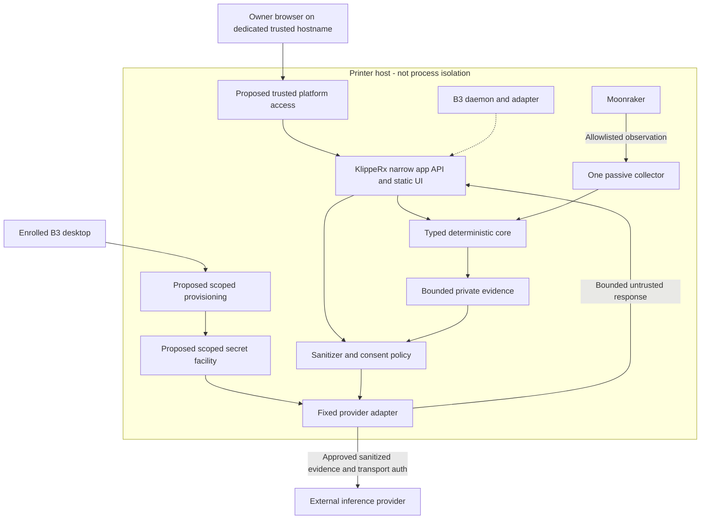

# Architecture

Approved design baseline v1.0. No implementation or runtime acceptance.

## F01 - Components and boundaries

Existing source-reported building blocks: manifest service, web-location, endpoint launcher, declared data, private dependency environment; daemon realizes lifecycle and recovery. Published startup scripts establish start/stop/autostart, not continuous readiness supervision or automatic restart. Failed update can deactivate and retain partial files; no guaranteed transactional rollback. Manifest permissions describe intended installation, not runtime confinement. The passive read allowlist is product enforcement, not a platform-enforced read-only principal. Proposed platform capabilities: gateway, provisioning, secret lifecycle and enforceable identity. The host box is not a security sandbox. No model-to-printer control edge. Native setup does not itself establish browser trust.

| Component / owner | Logical interface and invariants | Failure containment |
| --- | --- | --- |
| Platform daemon/adapter | Declare package, service, web route, data and minimum permissions; daemon owns install/update/uninstall/recover | No self-repair or core service manipulation by plugin |
| Collector / KlippeRx | Typed fixed read operations; single selective subscription; identity, timestamps and bounded backoff | Stale/gap flags, no tight retry or duplicate collectors |
| Core / KlippeRx | Typed immutable observations to deterministic findings with source, uncertainty, freshness | No inference needed; invalid data rejected or flagged |
| Evidence store / KlippeRx | Bounded records, quotas, schema versions; logical source IDs; no generic filesystem or SQL API | Bounded cleanup of app-owned evidence per policy; stop recording on reserve failure; never touch printer data |
| UI/API / KlippeRx | Enumerated operations; validate type, size, session, printer identity, permissions; static assets prebuilt | No arbitrary proxy, command, path, URL or model-selected tool dispatch |
| Privacy policy / KlippeRx | Prepare immutable sanitized evidence, digest and preview; consent bound to exact digest, printer, provider and purpose | Deny uncertain sanitization, stale consent or unsupported provider |
| Provider adapter / KlippeRx | Fixed provider origins, verified TLS, time/size limits, one inflight; secret only for transport auth; output as untrusted text | No auto paid retry, no fallback, local mode unaffected |
| Access/credential platform / B3 proposed | Authenticated owner delegation, scoped secret use and lifecycle invalidation | Fail closed; no direct secret retrieval by browser; no unauthenticated private endpoint |

Approved direction: CPython 3.11, asyncio, aiohttp, strict JSON, bounded SQLite and prebuilt static assets. See runtime.md and resource-budgets.md. Prefer minimal declaration of managed-service and web-location plus restart only if adapter requires for web activation; optional tile is later and may require Moonraker fragment. No Klipper extra, instrument patch, new serial access, printer runtime writes, generic shell/G-code, automatic test or restart interface. No mandatory companion, CLI, MCP, cloud account or broker. Optional MCP later has separate principal and shares collector. B3 install operations are distinct from application runtime permissions. No port or exact route claimed approved. Published UI port arbitration is not global backend allocation; require supported backend socket and route ownership/admission before deployment. Monitor collector gaps and readiness without inventing a watchdog or recovery hook. Local fixtures may be developed independently of cloud facilities only after separate implementation authorization; no target installation or private HTTP deployment.
